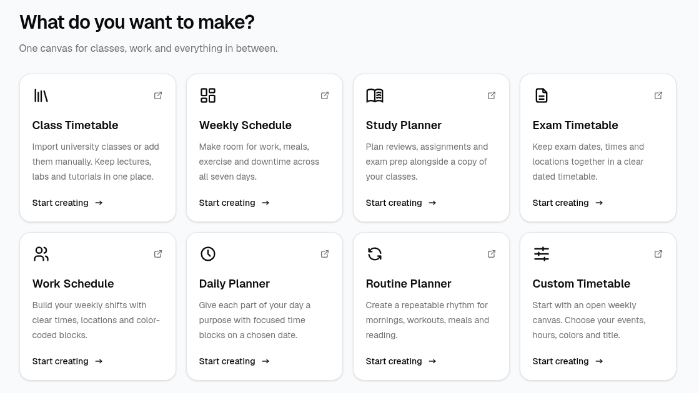
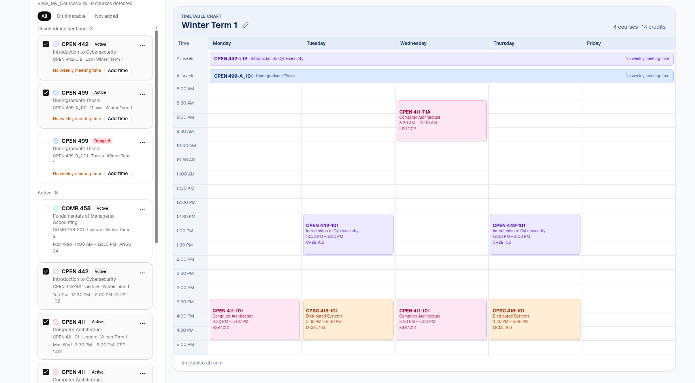
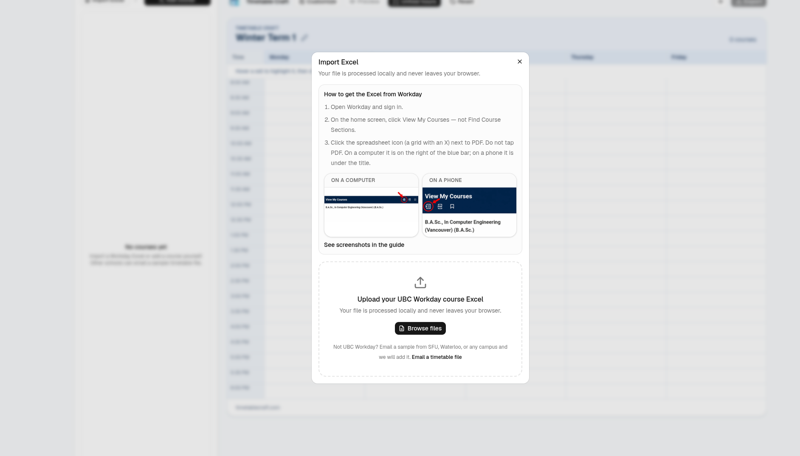
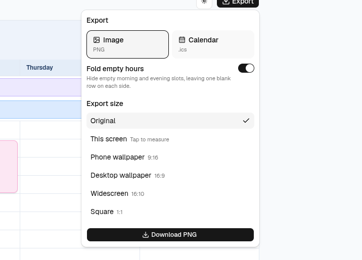

<p align="center">
  
</p>

<h1 align="center">Timetable Craft</h1>

<p align="center">
  <strong>Craft your time.</strong><br />
  Class timetables, weekly schedules, study plans, exams, shifts, daily plans and routines — made in the browser.<br />
  课程、周计划、学习、考试、排班、每日安排与作息，都在浏览器里完成。
</p>

<p align="center">
  <a href="https://timetablecraft.com">timetablecraft.com</a>
  ·
  <a href="mailto:lyuchongkai@gmail.com">lyuchongkai@gmail.com</a>
  ·
  English · 中文 · Français
</p>

Independent student project. Workday remains the source of record; confirm times and rooms there. **Not affiliated with UBC or Workday.**

独立学生项目。选课与时间以 Workday 为准。**与 UBC、Workday 无关。**

| | |
| --- | --- |
| Site / 站点 | [https://timetablecraft.com](https://timetablecraft.com) |
| Data / 数据 | This browser only. Each tool has its own `localStorage` key. / 只存在当前浏览器，每个工具一把独立的键。 |
| Theme / 主题 | light / dark / system |
| Export / 导出 | PNG · `.ics` · browser Print / Save as PDF |

---

## Screenshots / 界面

### Tools / 工具

One catalog. Pick what you want to make, then start from a template or a blank grid.

同一份工具列表。选一种时间表，从模板或空白格子开始。

<p align="center">
  
</p>

| Tool | Path | |
| --- | --- | --- |
| Class Timetable / 课表 | [`/tools/schedule-maker`](https://timetablecraft.com/tools/schedule-maker) | Lectures, labs and tutorials. Add them yourself, or import a Workday **View My Courses** Excel. / 手动添加，或导入 Workday 课程表。 |
| Weekly Schedule / 周计划 | `/tools/weekly-schedule` | Work, meals, exercise and downtime across seven days. / 七天里的工作、吃饭、运动和空档。 |
| Study Planner / 学习计划 | `/tools/study-planner` | Reviews and assignments beside a copy of your classes. / 复习和作业，可以抄一份当前课表。 |
| Exam Timetable / 考试表 | `/tools/exam-timetable` | Dated exams with times and rooms. / 带日期的考试、时间和地点。 |
| Work Schedule / 排班 | `/tools/work-schedule` | One person’s weekly shifts. / 单人一周班次。 |
| Daily Planner / 每日计划 | `/tools/daily-planner` | One chosen date, split into focused blocks. / 选定某一天，按时间块安排。 |
| Routine Planner / 作息 | `/tools/routine-planner` | A repeating week: mornings, workouts, meals, reading. / 可重复的一周节奏。 |
| Custom Timetable / 自定义 | `/tools/custom-timetable` | An open seven-day canvas. / 空白的七天画布。 |

### Class Timetable / 课表

Imported sections stay in the list until you check them. **Active** is a solid block, **Waitlist** is dashed, **Dropped** is dotted. Labs with no meeting pattern stay unscheduled so you can add a time.

导入后的课先留在左侧列表，勾选才上表。**在读**实心、**候补**虚线、**已退**点线。没有上课时间的实验课会标成未排课，方便补时间。

<p align="center">
  
</p>

### Import Excel / 导入表格

The file is read in this tab. Columns are matched by header name (`Course Listing`, `Section`, `Registration Status`, `Meeting Patterns`, `Instructor`, dates). Nothing is uploaded, and the spreadsheet is not rewritten.

文件只在当前标签页解析，按表头对列。不会上传，也不会改写原表。

<p align="center">
  
</p>

UBC Workday is the built-in path. A timetable from SFU, Waterloo, or another campus can be sent to [lyuchongkai@gmail.com](mailto:lyuchongkai@gmail.com).

目前内置的是 UBC Workday。SFU、Waterloo 或其他学校的课表可以发到邮箱。

### Export / 导出

PNG captures the timetable card. Calendar export writes an `.ics` file for Google, Apple, Outlook and Samsung. Image size can stay original, or fit a phone wallpaper (9:16), desktop wallpaper (16:9), widescreen (16:10), or a square. Fold empty hours leaves one blank row on each side of the used range.

PNG 只截课表卡片。日历导出是 `.ics`。尺寸可以保持原样，或做成手机壁纸、桌面壁纸、宽屏和正方形。折叠空白时段会在已用时间上下各留一行。

<p align="center">
  
</p>

Print and Save as PDF use the browser print dialog. Overnight shifts should be split at midnight. Calendar times are floating local times.

打印和另存为 PDF 走浏览器打印。跨夜班次请在午夜切开。日历时间是浮动的本地时间。

---

## Pages / 页面

| Path | Page | Indexable |
| --- | --- | --- |
| `/` | Landing / 首页 | yes |
| `/tools` | Tool index / 工具列表 | yes |
| `/tools/schedule-maker` | Class Timetable / 课表 | yes |
| `/tools/weekly-schedule` | Weekly Schedule | yes |
| `/tools/study-planner` | Study Planner | yes |
| `/tools/exam-timetable` | Exam Timetable | yes |
| `/tools/work-schedule` | Work Schedule | yes |
| `/tools/daily-planner` | Daily Planner | yes |
| `/tools/routine-planner` | Routine Planner | yes |
| `/tools/custom-timetable` | Custom Timetable | yes |
| `/ubc-timetable-maker` | UBC timetable maker / UBC 课表 | yes |
| `/guide` | How to export Excel from Workday / 导出指南 | yes |
| `/faq` | FAQ | yes |
| `/contact` | About and email / 介绍与联系 | yes |
| `/404` | Not found / 未找到 | **noindex** |

Legacy aliases redirect in the client: `/app` → `/tools/schedule-maker`; `/about`, `/features`, `/privacy` → `/contact`.

Unknown URLs render `/404` with `noindex`. They do not fall through to the home page.

旧地址会在前端跳转。未知地址渲染 `/404` 并 `noindex`，不会落回首页。

---

## Repository / 目录

```
TimetableCraft-WEB/
├── Dockerfile
├── start.sh / stop.sh
├── .env.dev              # Vite --mode dev         port 10404
├── .env.prod             # Vite --mode prod        https://timetablecraft.com
├── .env.prod.local       # Vite --mode prod.local  Docker on 10401
├── nginx/
├── public/               # favicon, og.png, robots, sitemap
├── docs/images/          # README screenshots
├── scripts/prerender.mjs
└── src/
    ├── pages/
    ├── components/       # timetable engine, planner workspace, course editor
    ├── parser/           # Excel, meeting patterns, course listings
    ├── stores/           # schedule.ts + one Zustand store per planner
    ├── config/planners.ts
    └── assets/language/  # en / zh / fr
```

React 19, Vite 8, TypeScript, Tailwind 4, React Router 8, i18next, zustand, xlsx, html-to-image, react-helmet-async. Playwright is for prerender and planner checks only.

---

## Develop / 本地开发

Host `node` and `npm` come from `/volume1/Environments`.

宿主机的 `node` / `npm` 来自 `/volume1/Environments`。

```bash
cd /volume1/Projects/TimetableCraft/TimetableCraft-WEB
source /volume1/Environments/use-menv.sh
npm ci
npm run dev          # http://localhost:10404
```

| Script | Mode | URL |
| --- | --- | --- |
| `npm run dev` | `.env.dev` | http://localhost:10404 |
| `npm run dev:prod-local` | `.env.prod.local` | http://192.168.1.64:10401 |
| `npm run dev:prod` | `.env.prod` | http://localhost:10405 |
| `npm run build` | prod | canonical `https://timetablecraft.com` |
| `npm run build:prod-local` | prod.local | what Docker runs |
| `npm run prerender` | | Playwright HTML snapshots |
| `npm run lint` | | oxlint |
| `npm run test:seo` | | route and meta checks |
| `npm run test:planners` | | browser regression; set `TEST_BASE_URL` / `CHROME_PATH` |

`src/constants/index.ts` sets `APP_URL` from `VITE_SITE_URL` (fallback `https://timetablecraft.com`) for canonical, Open Graph and JSON-LD.

### Docker

```bash
chmod +x start.sh stop.sh
./start.sh     # menv → docker build → :10401 → prerender into the container
./stop.sh
```

| | |
| --- | --- |
| Image | `timetablecraft-web:prod-local` |
| Container | `TimetableCraft-WEB-Prod-Local` |
| Publish | **10401 → 80** |
| Build | `npm run build:prod-local` in `node:22-alpine` |
| Serve | `nginx:1.27-alpine` |

`PRERENDER_SKIP=1` skips Playwright. `PRERENDER_ON_HOST=1` tries host Chromium first. Prerender follows `src/config/seo-routes.json` plus `/404`, then copies the HTML into the container so a crawler sees real headings and JSON-LD.

Public host is **https://timetablecraft.com**. Sample edge config: `nginx/timetablecraft.com.conf`. Keep the container on `NAS_IP:10401` and send HTTP and `www` to the apex.

---

## How the timetable is built / 课表怎么接起来

```
Workday Excel → Course[] → adapter → ScheduleEvent[] → TimetableEngine
Templates / forms → ScheduleEvent[] → TimetableEngine
```

- `src/parser/excelParser.ts` reads the sheet in the browser. Headers match by alias.
- `src/stores/schedule.ts` persists class data at `timetablecraft:v1` (it still reads the older `ubcexceltoschedule:v3` key).
- `src/stores/planners.ts` gives every other tool its own Zustand instance and `timetablecraft:planner:<id>:v1` key.
- Credits count a unique subject + number + term, so a lecture and its discussion do not double.
- Study Planner copies class blocks as independent events. Editing the copy does not change the class timetable.
- Templates append new event ids. They do not replace work already on the grid.
- Dated events match the exact date. A Monday exam does not repeat every Monday.
- Language lives in `localStorage` (`timetablecraft:lng`), then `navigator`. Theme is `timetablecraft:theme`, applied in `index.html` before React paints.
- Scope and follow-ups: [docs/planner-roadmap.md](docs/planner-roadmap.md).

---

## SEO

Already in the repo: prerendered HTML, `public/robots.txt`, `sitemap.xml`, canonical / Open Graph / Twitter cards, Organization / WebSite / SoftwareApplication JSON-LD, FAQPage and HowTo, `noindex` on `/404`.

After deploy, in Search Console:

1. Add the URL-prefix property `https://timetablecraft.com` and the domain property `timetablecraft.com`.
2. Verify, then submit `https://timetablecraft.com/sitemap.xml`.
3. Inspect `/` and `/tools/schedule-maker` and confirm the prerendered `<h1>` and JSON-LD, not an empty `#root`.

Language is stored in the browser today, so the prerendered pages are English. URL locales (`/zh`, `/fr`) and `hreflang` are still ahead.

语言目前写在浏览器里，预渲染页面是英文。`/zh`、`/fr` 和 `hreflang` 还没做。

---

## Privacy / 隐私

Parsing, layout, appearance and export run in this tab. Reset deletes the saved schedule from this browser only.

解析、排版、外观和导出都在当前标签页完成。重置只删除这个浏览器里保存的时间表。
